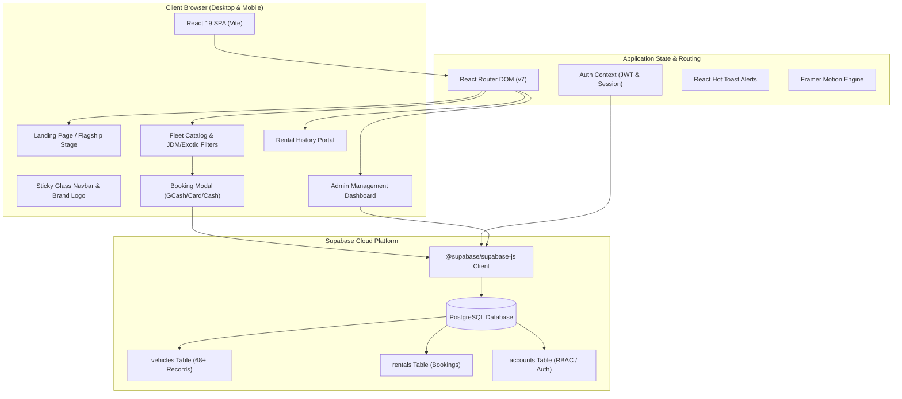
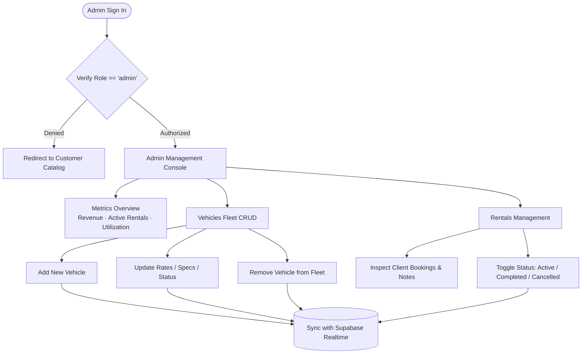
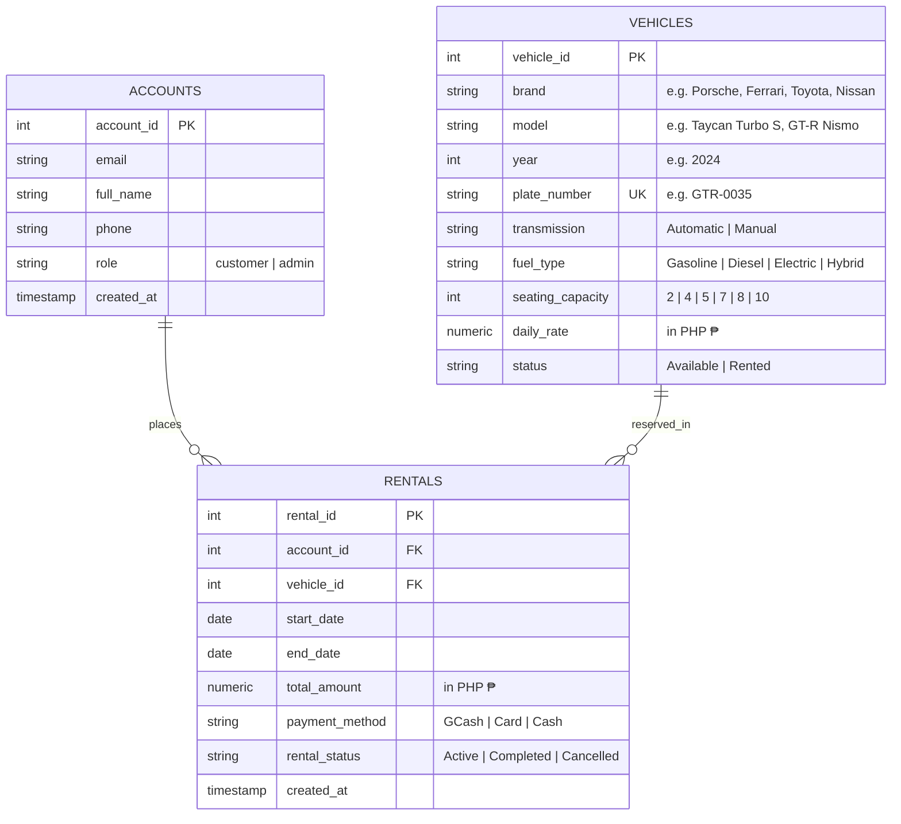

<div align="center">


# RentWheels

### Luxury, Exotic & Executive Car Rental Platform
**Metro Manila's premier web-based car rental ecosystem with instant paperless reservations.**

[](https://react.dev/)
[](https://vitejs.dev/)
[](https://tailwindcss.com/)
[](https://supabase.com/)
[](https://www.framer.com/motion/)
[](LICENSE)

---

</div>

## 📌 Table of Contents
- [Overview](#-overview)
- [Key Features](#-key-features)
- [System Architecture & Flowcharts](#-system-architecture--flowcharts)
  - [1. System Architecture & Tech Flow](#1-system-architecture--tech-flow)
  - [2. Customer Booking Lifecycle](#2-customer-booking-lifecycle)
  - [3. Admin Fleet Management Flow](#3-admin-fleet-management-flow)
- [Database Schema & ERD](#-database-schema--erd)
- [Fleet Showcase (68+ Vehicles)](#-fleet-showcase-68-vehicles)
- [Tech Stack](#-tech-stack)
- [Project Directory Structure](#-project-directory-structure)
- [Getting Started](#-getting-started)
- [Default Demo Credentials](#-default-demo-credentials)
- [Contributing & License](#-contributing--license)

---

## 🚗 Overview

**RentWheels** is a full-featured, modern web-based car rental platform tailored for the Philippine luxury and commercial automotive market. It combines an ultra-modern dark glassmorphism user interface with a robust backend powered by Supabase PostgreSQL.

With over **68 curated vehicles** spanning exotic supercars, ultra-luxury executive sedans, JDM Japanese icons, and high-capacity VIP people movers, RentWheels eliminates rental paperwork hurdles with instant digital vouchers, airport concierge turnovers (NAIA Terminals 1-3, BGC, Makati CBD), and real-time fleet tracking.

---

## ✨ Key Features

- **Dynamic Fleet Catalog:** Instant searching across 68+ vehicles by brand, model, plate, transmission, and fuel type.
- **Curated Category Filters:**
  - 🏎️ **Performance & Exotics:** Ferrari, Lamborghini, McLaren, Porsche, Audi R8, Aston Martin, Corvette.
  - 🇯🇵 **Japanese & JDM Fleet:** Nissan GT-R Nismo, Toyota GR Supra, Civic Type R FL5, Lancer Evolution X, Subaru WRX, Miata MX-5.
  - 🚙 **Prestige SUVs & 7-Seaters:** Land Cruiser 300, Defender 110 V8, Escalade ESV, Range Rover, Patrol Royale, G 63 AMG.
  - ⚡ **Electric & Hybrid:** Tesla Model 3/S, Porsche Taycan, Lucid Air, Mercedes EQS, Toyota Crown/Camry HEV.
  - 🟢 **Available Now:** Real-time availability filter.
- **60-Second Instant Reservation Modal:** Interactive date pickers, automatic duration calculation, transparent pricing breakdown, and payment options (GCash, Credit/Debit Card, Cash on Turnover).
- **Client Rental History:** Real-time customer portal for tracking active, completed, and pending bookings with generated rental reference codes.
- **Admin Fleet & Operations Console:** Full CRUD management over fleet inventory, instant status toggles (Available/Rented), real-time rental verification, and business metrics (fleet utilization, active rentals, total revenue).
- **Responsive Dark Glassmorphism UI:** Built with Tailwind CSS v4, custom ambient emerald/cyan gradients, and smooth Framer Motion micro-interactions.

---

## 📊 System Architecture & Flowcharts

### 1. System Architecture & Tech Flow



---

### 2. Customer Booking Lifecycle

```mermaid
flowchart LR
    Start([User Visits Website]) --> Browse[Explore Fleet Catalog]
    Browse --> Filter{Filter / Search Fleet}
    
    Filter -->|By Category| CatChoice[JDM / Exotic / SUV / EV]
    Filter -->|By Brand/Model| SearchQuery[Search Brand or Model]
    Filter -->|By Specs| SpecChoice[Transmission / Seats / Fuel]

    CatChoice --> SelectCar[Select Vehicle Card]
    SearchQuery --> SelectCar
    SpecChoice --> SelectCar

    SelectCar --> CheckAuth{User Signed In?}
    CheckAuth -->|No| PromptAuth[Redirect to Sign In / Sign Up]
    PromptAuth --> Modal
    CheckAuth -->|Yes| Modal[Open Reservation Modal]

    Modal --> PickDates[Select Start & End Dates]
    PickDates --> CalcRate[Auto Calculate Total Rate & Days]
    CalcRate --> Payment[Choose Payment Method\nGCash · Credit Card · Cash]
    Payment --> Submit[Confirm Booking]

    Submit --> SupaWrite[(Insert Record into rentals Table)]
    SupaWrite --> UpdateCar[(Update vehicle status to Rented)]
    UpdateCar --> Voucher[Generate Instant Digital Voucher]
    Voucher --> Turnover([Concierge Key Turnover\nNAIA / BGC / Makati])
```



---

### 3. Admin Fleet Management Flow



---

## 🗄️ Database Schema & ERD



---

## 🏆 Fleet Showcase (68+ Vehicles)

| Tier | Representative Models | Daily Rate Range |
| :--- | :--- | :--- |
| **Exotic Supercars** | Ferrari F8 Tributo, Lamborghini Huracán EVO, McLaren 720S, Audi R8 V10, Aston Martin Vantage, Corvette Z06, Maserati MC20 | ₱14,500 – ₱32,000 |
| **Ultra-Luxury Sedans** | Rolls-Royce Ghost Extended, Bentley Flying Spur Azure, Continental GT, Maybach S 680, Mercedes S 500, BMW 740i | ₱15,000 – ₱38,000 |
| **Japanese & JDM Icons** | Nissan GT-R Nismo, Toyota GR Supra, Civic Type R FL5, Lancer Evolution X, Subaru WRX, Miata MX-5, GR Yaris, GR Corolla | ₱6,000 – ₱25,000 |
| **Prestige & Off-Road SUVs** | Land Cruiser 300 GR-S, Prado 250, Defender 110 V8, Escalade ESV, Range Rover Autobiography, Patrol Royale, G 63 AMG | ₱4,200 – ₱25,000 |
| **High-Performance EVs** | Porsche Taycan Turbo S, Tesla Model S Plaid, Tesla Model 3 Long Range, Nissan Ariya, Lucid Air | ₱6,800 – ₱16,500 |
| **Executive VIP Chauffeur** | Lexus LM 350h Executive Lounge, Toyota Alphard Royal Lounge, HiAce Super Grandia Elite, Innova Zenix Q | ₱4,500 – ₱19,000 |

---

## 🛠️ Tech Stack

- **Frontend Core:** React 19, JavaScript (ESNext), Vite 8
- **Styling & Design:** Tailwind CSS v4, Lucide React Icons
- **Animation:** Framer Motion 12
- **Routing & State:** React Router DOM v7, React Context API
- **Backend as a Service:** Supabase (PostgreSQL, Supabase Auth, Row-Level Security)
- **Notifications:** React Hot Toast

---

## 📂 Project Directory Structure

```text
RentWheels/
├── public/
│   ├── favicon.svg          # Official glowing turbine wheel favicon
│   ├── logo.svg             # Full-res RentWheels vector brand emblem
│   └── vite.svg             # Fallback alias icon
├── src/
│   ├── components/
│   │   ├── BookingModal.jsx # 60s reservation & payment modal
│   │   ├── Footer.jsx       # Global footer with verified badges
│   │   ├── Modal.jsx        # Accessible base modal dialog
│   │   ├── Navbar.jsx       # Sticky glass navigation bar
│   │   └── VehicleCard.jsx  # High-res vehicle card with active fallback
│   ├── context/
│   │   └── AuthContext.jsx  # Authentication & session provider
│   ├── lib/
│   │   └── supabase.js      # Supabase client initialization
│   ├── pages/
│   │   ├── AdminDashboard.jsx  # Admin fleet CRUD & metrics
│   │   ├── CustomerPortal.jsx  # Fleet catalog & multi-filter portal
│   │   ├── LandingPage.jsx     # Centered hero, stats & showcase
│   │   ├── LoginPage.jsx       # User sign-in with quick credentials
│   │   ├── RentalHistory.jsx   # Booking history & voucher records
│   │   └── SignupPage.jsx      # New account registration
│   ├── App.jsx              # Application router configuration
│   ├── index.css            # Tailwind CSS v4 & custom glass styling
│   └── main.jsx             # React DOM root entrypoint
├── .env.example             # Environment template
├── package.json             # Dependencies & build scripts
├── vite.config.js           # Vite configuration (Tailwind & React plugins)
└── README.md                # Comprehensive documentation & flowcharts
```

---

## 🚀 Getting Started

### Prerequisites
- Node.js (v18 or higher recommended)
- npm or pnpm

### Installation

1. **Clone the repository:**
   ```bash
   git clone https://github.com/17appledog/RentWheels.git
   cd RentWheels
   ```

2. **Install dependencies:**
   ```bash
   npm install
   ```

3. **Configure Environment Variables:**
   Create a `.env` file in the root directory (or copy from `.env.example`):
   ```env
   VITE_SUPABASE_URL=https://vmxbisjidcailbgbahfg.supabase.co
   VITE_SUPABASE_ANON_KEY=your_supabase_anon_key_here
   ```

4. **Start the Development Server:**
   ```bash
   npm run dev
   ```
   Open [http://localhost:5173](http://localhost:5173) in your browser.

5. **Build for Production:**
   ```bash
   npm run build
   ```
   The compiled output will be generated in the `dist/` directory.

---

## 🔑 Default Demo Credentials

For quick testing and evaluation, pre-configured roles are available directly on the [Sign In Page](http://localhost:5173/login):

| Role | Email | Password | Access Level |
| :--- | :--- | :--- | :--- |
| **Administrator** | `admin@rentwheels.com` | `admin123` | Full access to Admin Console, Fleet CRUD & Analytics |
| **Customer** | `customer@rentwheels.com` | `customer123` | Fleet browsing, instant reservation, booking history |

---

## 📄 Contributing & License

Contributions, issues, and feature requests are welcome!  
Distributed under the **MIT License**. See `LICENSE` for details.

Developed with ❤️ for automotive enthusiasts and discerning drivers in Metro Manila.
